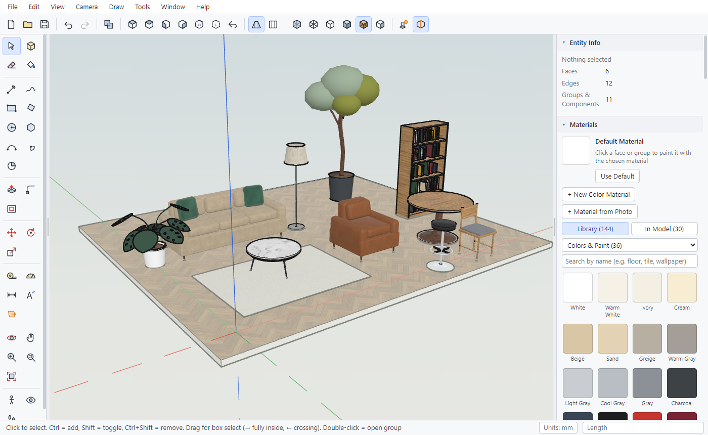
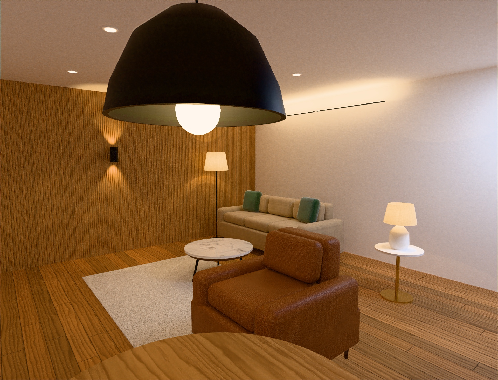
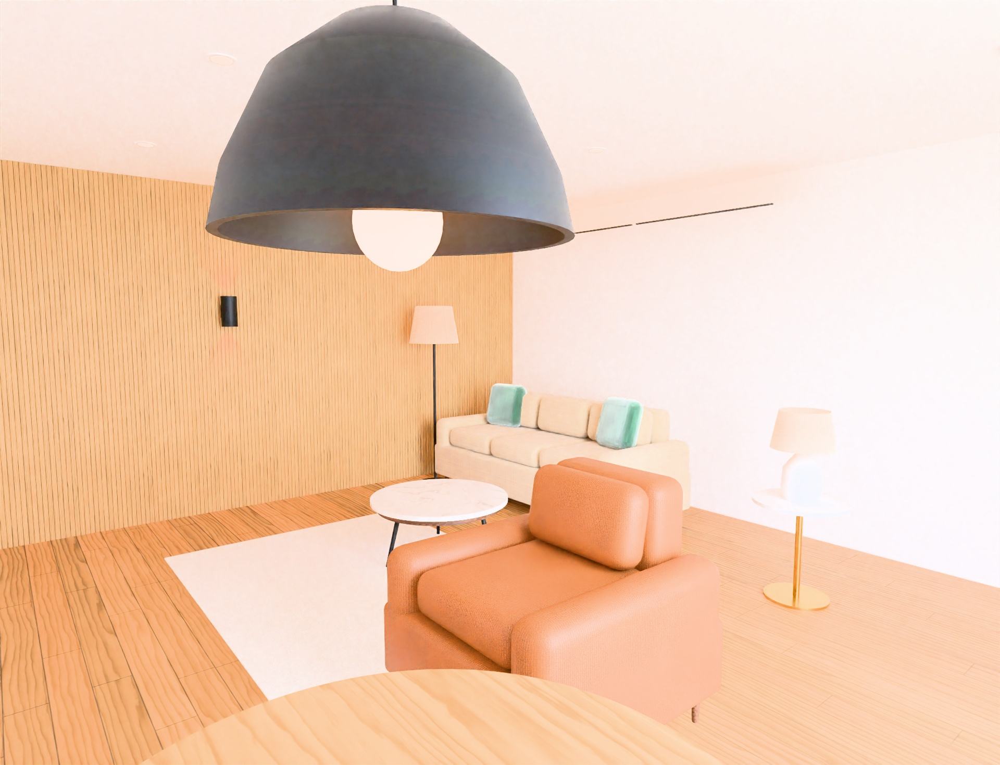

# SimpleSketch 3D

**A free, open-source 3D modeling app for Windows — easy push/pull modeling for interiors and architecture.**

[English](#english) · [한국어](#한국어) · [日本語](#日本語) · [中文](#中文)



<p> </p>

*Rendered in the app with one click (F9) — the same room at night (lamps, downlights, wall sconce, cove LED) and by day. The model comes with the download as `samples/lighting-living-room.s3d` (in this repository: `public/samples`).*

> ⚠️ **SketchUp `.skp` files are not supported yet.** This version cannot open or save `.skp` files. Support is planned for a later update once Trimble (the maker of SketchUp) approves the use of its SDK. Until then, export **DAE** from SketchUp and use **File → Import**.
>
> 💬 **Feedback wanted!** This is an early version. Please report bugs and ideas in [Issues](../../issues) — any language is welcome (English, 한국어, 日本語, 中文).

---

## English

SimpleSketch 3D is a desktop 3D modeler in the spirit of classic push/pull modeling: draw a rectangle, pull it up into a box, draw a line across a face to split it, push it in to cut a hole. It is made for quick interior and architectural models.

**Free. No account, no subscription, no telemetry.** The app works fully offline.

### Features
- Drawing: line, freehand, rectangle, rotated rectangle, circle, polygon, arcs, pie
- Editing: push/pull (with cut-through), move/copy with arrays (`x5`, `/5`), rotate, scale, offset, follow me, eraser, soften
- Inference: endpoints, midpoints, on-edge/on-face, axis locks, parallel/perpendicular
- Groups and components (edit one, all copies change), solid merge
- 144 built-in materials with physically based rendering (wood, tile, stone, metal, glass, fabric…), materials from your own photos
- 58 built-in components: furniture, kitchen and bath, appliances, doors and windows that cut openings in walls, stairs, trees, people, a car
- Tags, outliner, scenes, styles (wireframe, hidden line, shaded, textured, X-ray), sun shadows by city/date/time, section planes, dimensions, text, tape measure, protractor, walk-through
- **One-click photo-like rendering** (F9): GPU path tracing with denoising, sun by time of day, orbit the view and it re-renders in seconds, save PNG/JPG up to 4K
- **Real lighting**: lamps, downlights, panel lights, wall sconces and cove LED bars light the scene, with per-light on/off, lumens and color temperature (2700K–6500K), plus Day / Evening / Night presets
- Import: DAE, OBJ, STL, glTF/GLB, DXF, images · Export: DAE, OBJ, STL, GLB, DXF, PNG/JPG
- Interface in **English, 한국어, 日本語, 中文** (Help → Language)

### SketchUp (.skp) support — coming later
`.skp` open/save is **not included in this version**. It will be added in a later update after Trimble approves the use of the SketchUp SDK (the request is under review). This release contains no SketchUp SDK code or files. Exchange models with SketchUp through DAE for now.

### Download and run
1. Download `SimpleSketch3D-<version>-win-x64.zip` from the [Releases](../../releases) page.
2. Unzip it anywhere and run `SimpleSketch3D.exe`.
3. Windows may show "Windows protected your PC" because the app is not code-signed yet. Click **More info → Run anyway**.

Requirements: Windows 10/11, 64-bit. Rendering needs a graphics card with WebGPU support (most GPUs from the last several years with an up-to-date driver).

Try it: open `samples/lighting-living-room.s3d` (File → Open) and press **Render** (F9). In the render window, use **Day / Evening / Night**. Select a lamp to change its brightness (lumens) and color temperature in Entity Info.

### Feedback
Bugs, missing features, translation fixes — please open an [issue](../../issues) or use **Help → Send Feedback** in the app.

### Build from source
```
npm install
npm test                 # geometry engine tests
npm start                # run in development
npm run build:public     # package into %TEMP%\sketch3d-build\SimpleSketch3D and make the release zip
```
Translations live in `app/js/i18n-dict.js`. Run `npm run i18n:check` to find missing ones.

### License
MIT — see [LICENSE](LICENSE). Third-party licenses: [THIRD-PARTY-NOTICES.md](THIRD-PARTY-NOTICES.md).

SketchUp is a trademark of Trimble Inc. SimpleSketch 3D is an independent project and is not affiliated with or endorsed by Trimble.

---

## 한국어

SimpleSketch 3D는 밀기/끌기 방식으로 쉽게 쓰는 무료 3D 모델링 프로그램이야. 사각형을 그려 위로 끌어올리면 상자가 되고, 면 위에 선을 그어 나눈 뒤 밀어 넣으면 구멍이 뚫려. 인테리어·건축 모델을 빨리 만드는 데 맞춰 만들었어.

**무료, 회원 가입·구독·정보 수집 없음.** 인터넷 없이도 다 돼.

- 그리기·고치기 도구 30여 개, 그룹·컴포넌트, 합치기
- 재질 144개(나무·타일·돌·금속·유리·천 등, 사진으로 재질 만들기), 컴포넌트 58개(가구·주방·욕실·가전·문·창문·계단·나무·사람·차)
- 태그, 아웃라이너, 장면, 스타일, 그림자(도시·날짜·시각), 단면, 치수, 걷기
- **버튼 하나로 사진 같은 렌더링** (F9): 그래픽 카드로 빛을 추적하고 노이즈를 지움, 시각에 따라 해 위치, 끌어서 돌려 보면 몇 초 만에 다시 계산, 4K까지 PNG/JPG 저장
- **진짜 조명**: 스탠드·다운라이트·평판등·벽등·간접조명 LED 바가 빛을 냄. 조명마다 켜기·밝기(루멘)·색온도(2700K~6500K), 낮/저녁/밤 단추
- 가져오기: DAE·OBJ·STL·glTF·DXF·그림 / 내보내기: DAE·OBJ·STL·GLB·DXF·PNG
- 화면 언어: 한국어·English·日本語·中文 (도움말 → 언어)

**⚠️ 스케치업 파일(.skp)은 아직 지원하지 않아.** 이번 판에서는 .skp를 열거나 저장할 수 없어. 스케치업을 만든 Trimble의 SDK 사용 승인을 기다리는 중이고, 승인이 나면 나중에 업데이트로 넣을 거야. 이번 판에는 스케치업 SDK 코드나 파일이 전혀 들어 있지 않아. 그때까지는 스케치업에서 DAE로 내보낸 뒤 **파일 → 가져오기**로 열어 줘.

**예제**: `samples/lighting-living-room.s3d`를 열고 **렌더링**(F9) → 렌더링 창에서 낮/저녁/밤. 조명을 고르면 엔티티 정보에서 밝기(루멘)·색온도를 바꿀 수 있어.

**실행**: [Releases](../../releases)에서 zip을 받아 아무 데나 풀고 `SimpleSketch3D.exe` 실행. "Windows의 PC 보호" 창이 뜨면 **추가 정보 → 실행**.

**의견 환영**: 아직 초기 버전이라 버그·불편한 점·원하는 기능을 [Issues](../../issues)에 남겨 줘(한국어로 써도 돼). 앱 안에서는 **도움말 → 의견 보내기**.

## 日本語

SimpleSketch 3D は、プッシュ/プル方式でかんたんに使える無料の 3D モデリングソフトです。長方形を描いて引き上げれば箱に、面に線を引いて押し込めば穴が開きます。インテリア・建築のモデルを素早く作るためのソフトです。

**無料・アカウント不要・サブスクなし・データ収集なし。** オフラインで動きます。

- 描画・編集ツール 30 種類以上、グループ・コンポーネント、ソリッド結合
- マテリアル 144 種（木・タイル・石・金属・ガラス・布など、写真からも作成可）、コンポーネント 58 種（家具・キッチン・浴室・家電・ドア・窓・階段・樹木・人物・車）
- タグ、アウトライナー、シーン、スタイル、影（都市・日付・時刻）、断面、寸法、ウォーク
- **ボタンひとつで写真のようなレンダリング**（F9）: GPU パストレーシング＋ノイズ除去、時刻に合わせた太陽、ドラッグで回すと数秒で再計算、4K まで PNG/JPG 保存
- **本物の照明**: スタンド・ダウンライト・パネルライト・ブラケット・間接照明 LED バーが光る。照明ごとに点灯・明るさ（ルーメン）・色温度（2700K〜6500K）、昼/夕方/夜ボタン
- インポート: DAE・OBJ・STL・glTF・DXF・画像 / エクスポート: DAE・OBJ・STL・GLB・DXF・PNG
- 表示言語: 日本語・English・한국어・中文（ヘルプ → 言語）

**⚠️ SketchUp ファイル（.skp）にはまだ対応していません。** このバージョンでは .skp を開くことも保存することもできません。SketchUp の開発元 Trimble による SDK 利用の承認を待っており、承認後のアップデートで対応する予定です。このバージョンには SketchUp SDK のコードやファイルは一切含まれていません。それまでは SketchUp で DAE にエクスポートし、**ファイル → インポート** で開いてください。

**サンプル**: `samples/lighting-living-room.s3d` を開いて **レンダリング**（F9）→ レンダリングウィンドウで昼/夕方/夜。照明を選ぶとエンティティ情報で明るさ（ルーメン）・色温度を変更できます。

**起動方法**: [Releases](../../releases) から zip をダウンロードして展開し、`SimpleSketch3D.exe` を実行。「Windows によって PC が保護されました」と出たら **詳細情報 → 実行**。

**フィードバック歓迎**: まだ初期バージョンです。不具合や要望を [Issues](../../issues) にお寄せください（日本語で大丈夫です）。アプリ内では **ヘルプ → フィードバックを送る**。

## 中文

SimpleSketch 3D 是一款用“推/拉”方式轻松建模的免费 3D 软件。画一个矩形向上拉就成了盒子，在面上画线分割后往里推就能开洞。专为快速制作室内和建筑模型而设计。

**免费、无需注册、无订阅、不收集数据。** 完全离线可用。

- 30 多种绘图和编辑工具，组与组件，实体合并
- 144 种材质（木材、瓷砖、石材、金属、玻璃、布艺等，也可用照片制作），58 个组件（家具、厨卫、家电、门窗、楼梯、树木、人物、汽车）
- 标记、大纲、场景、风格、阴影（城市·日期·时间）、剖切、尺寸、漫游
- **一键照片级渲染**（F9）：GPU 路径追踪 + 降噪，按时刻设置太阳，拖动旋转后几秒内重新计算，最高 4K 保存 PNG/JPG
- **真实灯光**：落地灯、筒灯、平板灯、壁灯、间接照明 LED 灯条都会发光。每个灯可开关、调亮度（流明）和色温（2700K~6500K），还有白天/傍晚/夜晚按钮
- 导入：DAE·OBJ·STL·glTF·DXF·图片 / 导出：DAE·OBJ·STL·GLB·DXF·PNG
- 界面语言：中文·English·한국어·日本語（帮助 → 语言）

**⚠️ 暂不支持 SketchUp 文件（.skp）。** 本版本无法打开或保存 .skp 文件。我们正在等待 SketchUp 开发商 Trimble 批准使用其 SDK，获批后将通过更新加入。本版本不包含任何 SketchUp SDK 代码或文件。在此之前，请在 SketchUp 中导出 DAE，再用 **文件 → 导入** 打开。

**示例**：打开 `samples/lighting-living-room.s3d`，点击 **渲染**（F9），在渲染窗口中切换白天/傍晚/夜晚。选中灯具后可在图元信息中修改亮度（流明）和色温。

**运行**：从 [Releases](../../releases) 下载 zip，解压到任意位置，运行 `SimpleSketch3D.exe`。如果出现“Windows 已保护你的电脑”，点 **更多信息 → 仍要运行**。

**欢迎反馈**：这还是早期版本，欢迎在 [Issues](../../issues) 提交问题和建议（可以用中文）。程序内可用 **帮助 → 发送反馈**。
